<div align="center">


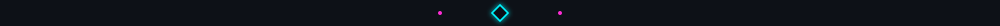

</div>

### <samp>❯ 01 · О СЕБЕ</samp>

<table align="center" border="0">
<tr>
<td width="55%" valign="top">

```ini
[ user ]
  name     = Bugulmek
  role     = разработчик утилит для Windows
  focus    = GUI · автоматизация · обход блокировок
  langs    = PowerShell, C++, Java
  contact  = lordsamper9@gmail.com
```

</td>
<td width="45%" valign="top">

- ⚡ Делаю **удобные GUI** там, где обычно живёт консоль
- 🛡️ Развиваю **[zapret-gui](https://github.com/Bugulmekas/zapret-gui)** — служба, стратегии, IPSet
- 🧪 Экспериментирую с **C++ / Java / PowerShell**
- 🎯 Люблю, когда «просто работает» и выглядит аккуратно

</td>
</tr>
</table>

<div align="center">


### <samp>❯ 02 · СТЕК</samp>

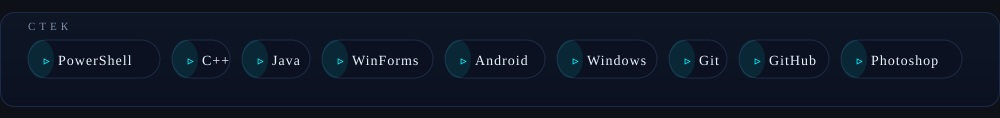


### <samp>❯ 03 · СТАТИСТИКА</samp>

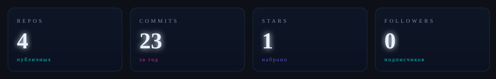

<br/>

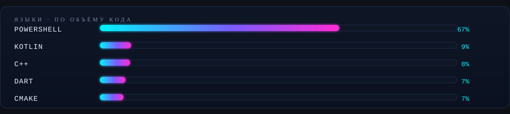

<br/>

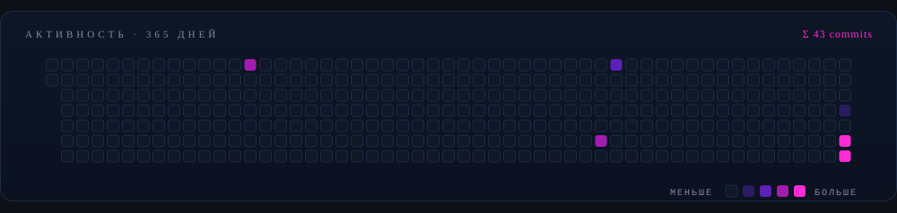


### <samp>❯ 04 · ЗМЕЙКА</samp>

<picture>
  <source media="(prefers-color-scheme: dark)" srcset="https://raw.githubusercontent.com/Bugulmekas/Bugulmekas/output/github-contribution-grid-snake-dark.svg" />
  <source media="(prefers-color-scheme: light)" srcset="https://raw.githubusercontent.com/Bugulmekas/Bugulmekas/output/github-contribution-grid-snake.svg" />
  
</picture>


### <samp>❯ 05 · ПРОЕКТЫ</samp>

<a href="https://github.com/Bugulmekas/zapret-gui">
  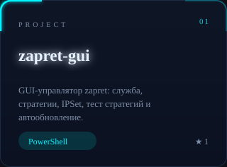
</a> <a href="https://github.com/Bugulmekas/dpi-bypass">
  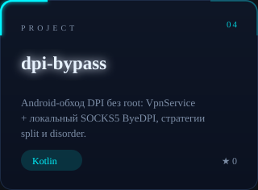
</a>

<br/>

<a href="https://github.com/Bugulmekas/Lavka_helper">
  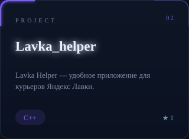
</a> <a href="https://github.com/Bugulmekas/LoveApp">
  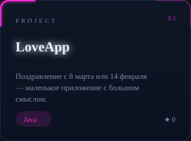
</a>


### <samp>❯ 06 · КОНТАКТЫ</samp>

<a href="mailto:lordsamper9@gmail.com">
  
</a>
<a href="https://github.com/Bugulmekas?tab=repositories">
  
</a>
<a href="https://github.com/Bugulmekas?tab=followers">
  
</a>

<br/><br/>

<i>«Хороший интерфейс — тот, о котором не думаешь.»</i>

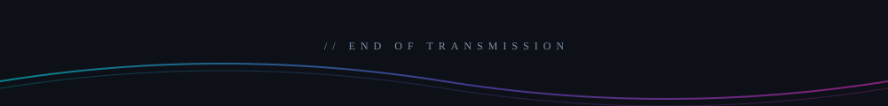

</div>
